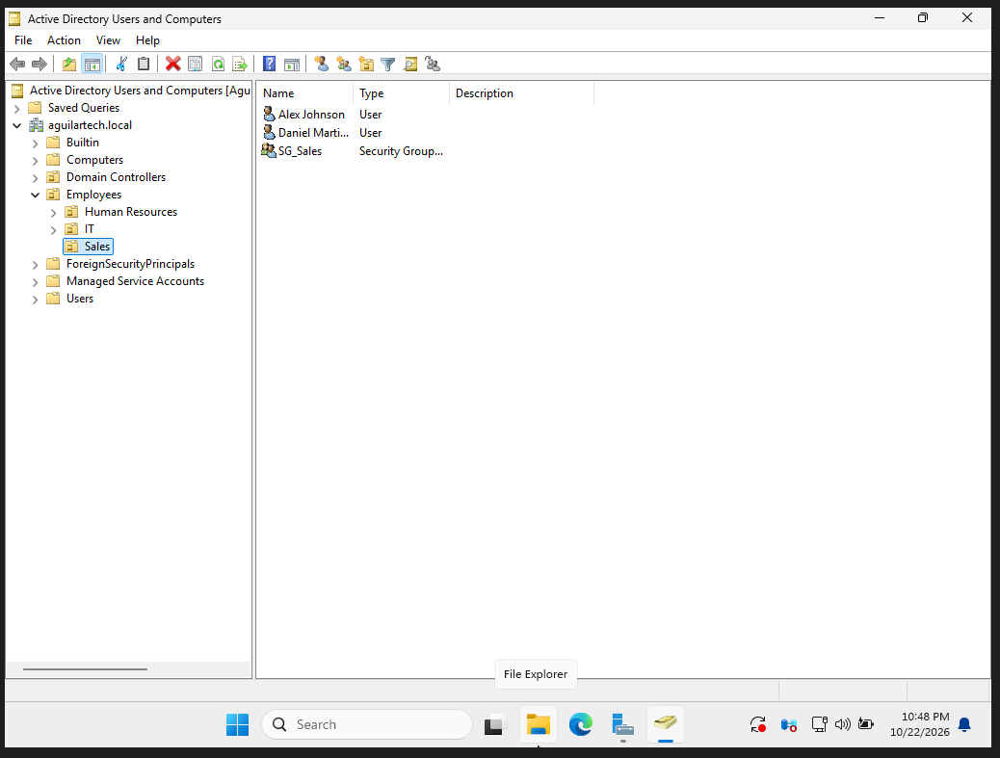
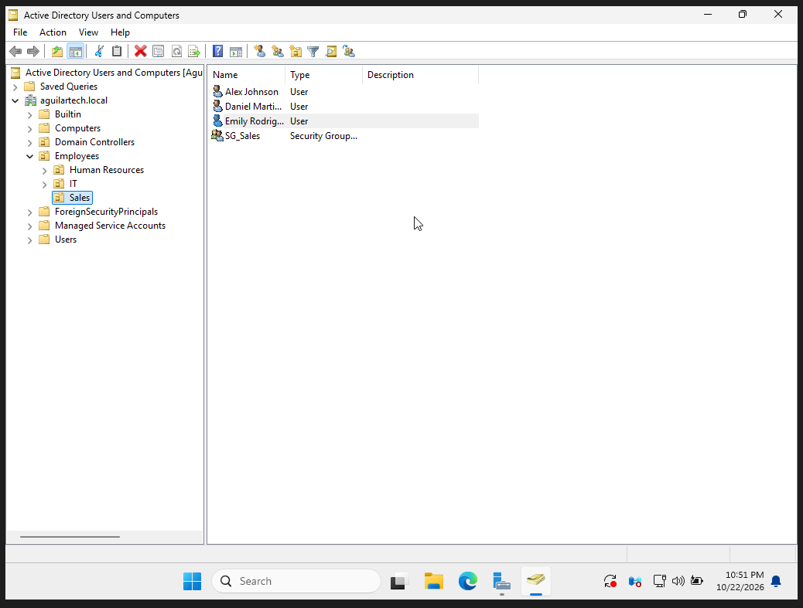
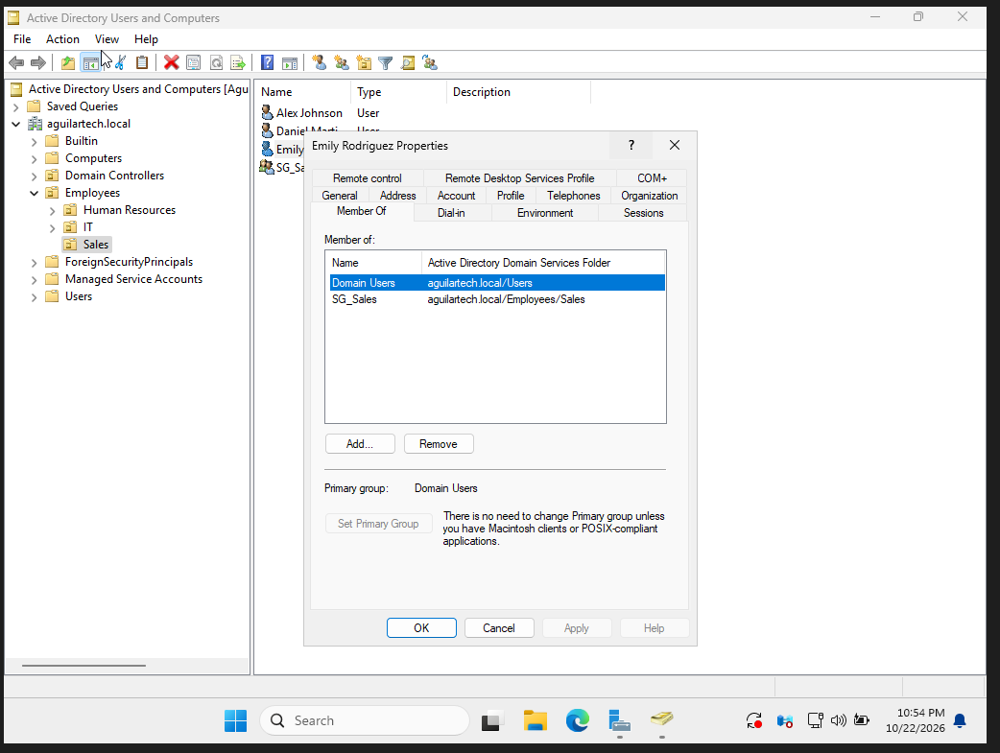
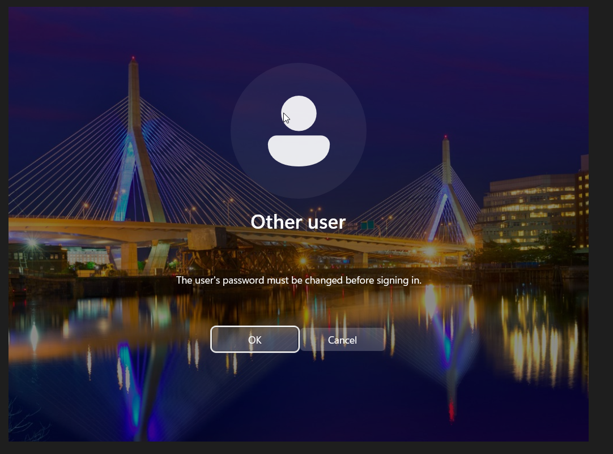
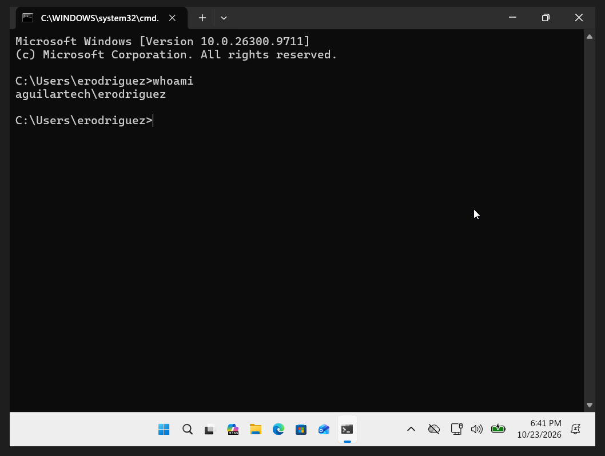
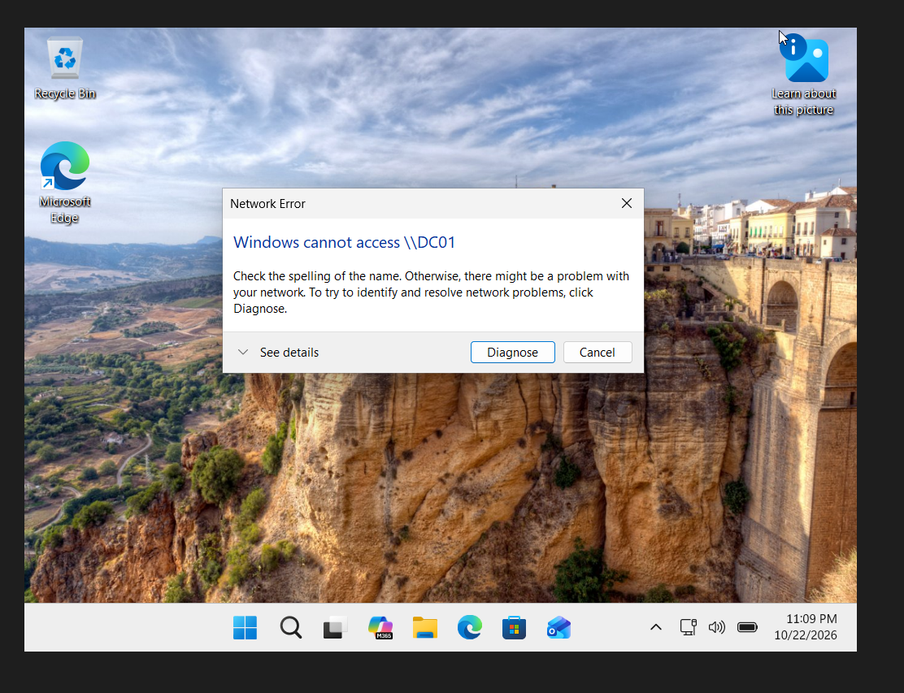
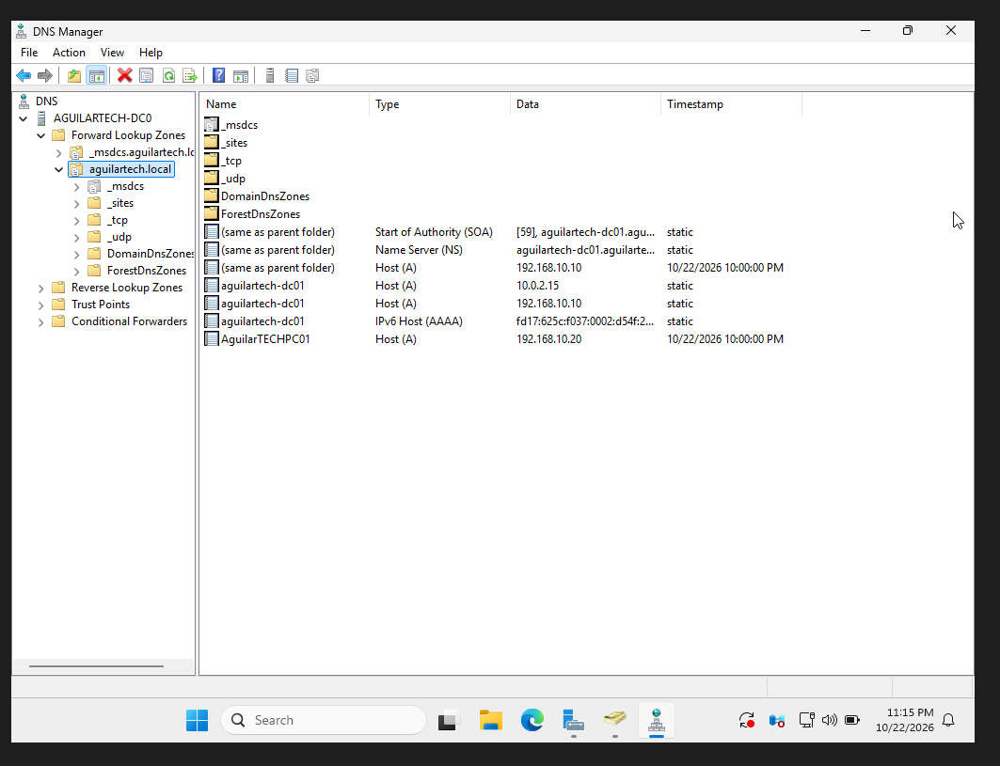
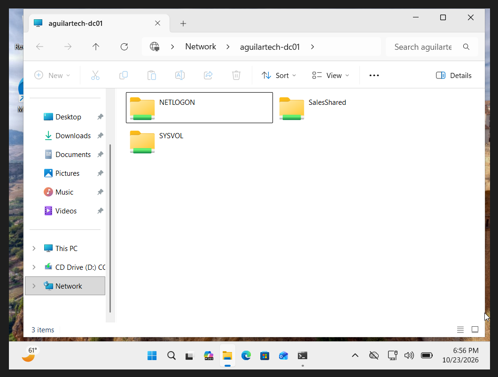
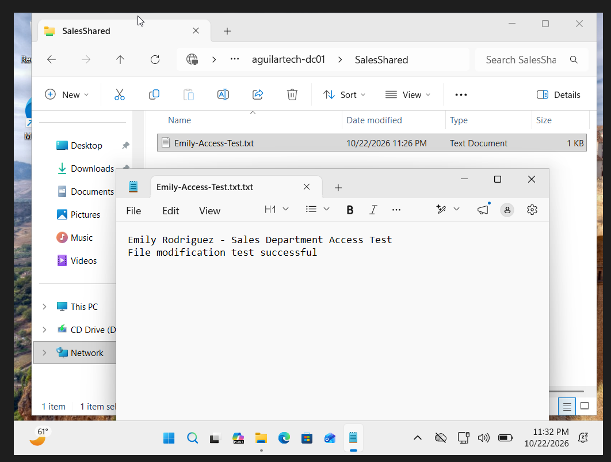

# Help Desk Ticket HD-002 - New Employee Account Setup

**Ticket ID:** HD-002  
**Category:** User Account Management / Active Directory  
**Priority:** Medium  
**Status:** Completed with a documented password-change limitation

## Ticket Summary

A new employee, Emily Rodriguez, joined the Sales department and needed an Active Directory account, the appropriate security group membership, and access to the department's shared folder.

The goal was to simulate a typical Help Desk onboarding request by creating the employee account, assigning group-based permissions, testing domain authentication, and verifying access to company resources.

## Lab Environment

- **Domain Controller:** DC01 (Windows Server, Active Directory Domain Services)
- **Workstation:** PC01 (Windows 11 Pro)
- **Domain:** aguilartech.local
- **Employee:** Emily Rodriguez
- **Username:** erodriguez
- **Organizational Unit:** Employees > Sales
- **Security Group:** SG_Sales
- **Shared Folder:** SalesShared
- **Virtualization:** Oracle VirtualBox

## Troubleshooting and Configuration Steps

### 1. Reviewed the Existing Sales OU

Opened Active Directory Users and Computers on DC01 and navigated to the Sales OU.

Reviewed the existing accounts and security group before creating the new employee account. This helped confirm the correct location for Emily's account and avoid unnecessary changes to other users.

### 2. Created the Employee Account

Created a new Active Directory user account for Emily Rodriguez inside the Sales OU.

Assigned the username `erodriguez` and configured an initial temporary password. Enabled the option requiring the user to change the password at the next sign-in.

Verified that Emily's account appeared in the correct organizational unit.

### 3. Assigned Security Group Membership

Opened Emily's account properties and navigated to the Member Of tab.

Added Emily to the existing `SG_Sales` security group and confirmed her membership.

Using security groups helps administrators manage permissions consistently without assigning separate permissions to every employee.

### 4. Tested the Password Change Requirement

Attempted to sign in to PC01 using Emily's new domain account.

Windows displayed a message requiring a password change before sign-in. However, the password-change process did not complete successfully during testing.

After troubleshooting the issue, I temporarily disabled the requirement to change the password at the next sign-in so I could continue testing the account.

**Unresolved limitation:** The forced password-change process was not successfully verified. This would need to be resolved before considering the account fully ready for production use.

### 5. Verified Domain Login

After adjusting the account setting, I successfully signed in to the Windows 11 workstation using Emily's domain credentials.

Used Command Prompt to verify the signed-in account.

This confirmed that the new Active Directory account could authenticate and access the domain-joined workstation.

### 6. Investigated Network Share Access Failure

Attempted to access the domain controller's shared resources from Emily's workstation.

Windows displayed a network error indicating that it could not access `\\DC01`.

I initially considered whether the problem involved Emily's security group membership or folder permissions. However, I investigated network connectivity and DNS before changing permissions.

Troubleshooting included checking the workstation's IP configuration and DNS settings, testing connectivity to `192.168.10.10`, and attempting to resolve the server name using `ping` and `nslookup`.

The workstation could reach the server by IP address, but the short hostname `DC01` did not resolve. This indicated a name-resolution issue rather than a complete network connectivity failure.

### 7. Investigated DNS Records and Server Naming

Opened DNS Manager on DC01 and reviewed the forward lookup zone for `aguilartech.local`.

Verified the domain controller's DNS records and identified its actual hostname as `aguilartech-dc01`.

The DNS records also included multiple addresses for the domain controller, including its host-only network address and a NAT network address.

From PC01, I successfully resolved and pinged `aguilartech-dc01`, confirming that the correct hostname resolved to `192.168.10.10`.

This showed that the original access attempt used the wrong server name. The investigation also highlighted why accurate DNS records and server naming are important when troubleshooting network resources.

### 8. Verified Shared Folder Access

After identifying the correct server hostname, I accessed the domain controller through File Explorer using `\\aguilartech-dc01`.

Windows displayed the available network shares, including `SalesShared`.

I opened the SalesShared folder using Emily's account and confirmed that she could access the department's shared resources.

### 9. Tested File Modification Permissions

To verify Emily's access beyond simply opening the shared folder, I tested her ability to create and modify a text document inside `SalesShared`.

Created a test document identifying Emily Rodriguez and the Sales department, then added the message:

`File modification test successful`

The file modification was successful, demonstrating that Emily had write access to the shared folder.

## Resolution

Successfully created Emily Rodriguez's Active Directory account in the Sales OU, assigned membership to `SG_Sales`, verified domain authentication, and confirmed access to the Sales department's shared folder.

Resolved the network share access issue by identifying the correct domain controller hostname and verifying DNS name resolution.

**Remaining issue:** The forced password-change requirement was bypassed for lab testing and remains unresolved. This would require additional troubleshooting before production deployment.

## What I Learned

- How to create and organize employee accounts in Active Directory.
- Why security groups are useful for managing employee access.
- How to verify domain authentication on a Windows 11 workstation.
- How to distinguish DNS name-resolution problems from network connectivity problems.
- How to use `ipconfig`, `ping`, and `nslookup` during troubleshooting.
- Why it is important to verify shared-folder access and file modification permissions.
- How to document unresolved issues accurately rather than claiming every problem was fixed.

## Skills Demonstrated

**Active Directory | User Account Management | Security Groups | Windows 11 | DNS Troubleshooting | Network Shares | Access Verification | Technical Documentation**
