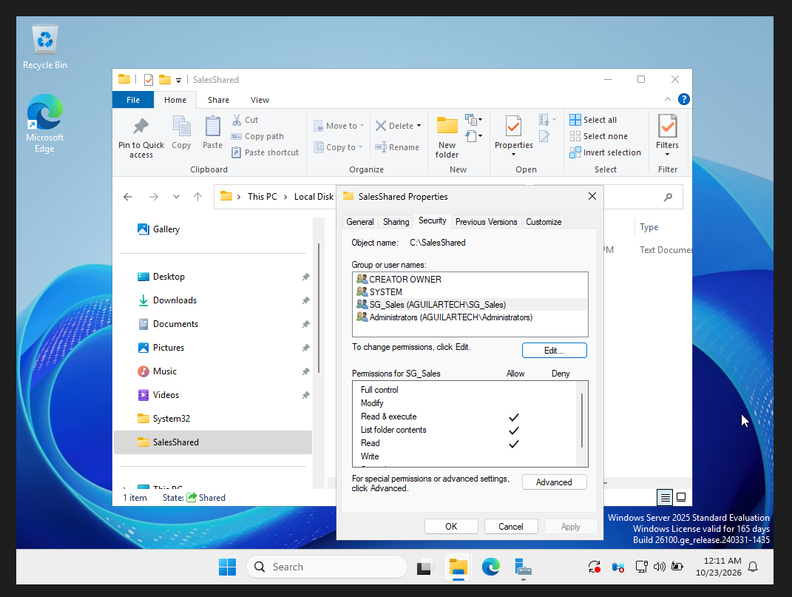
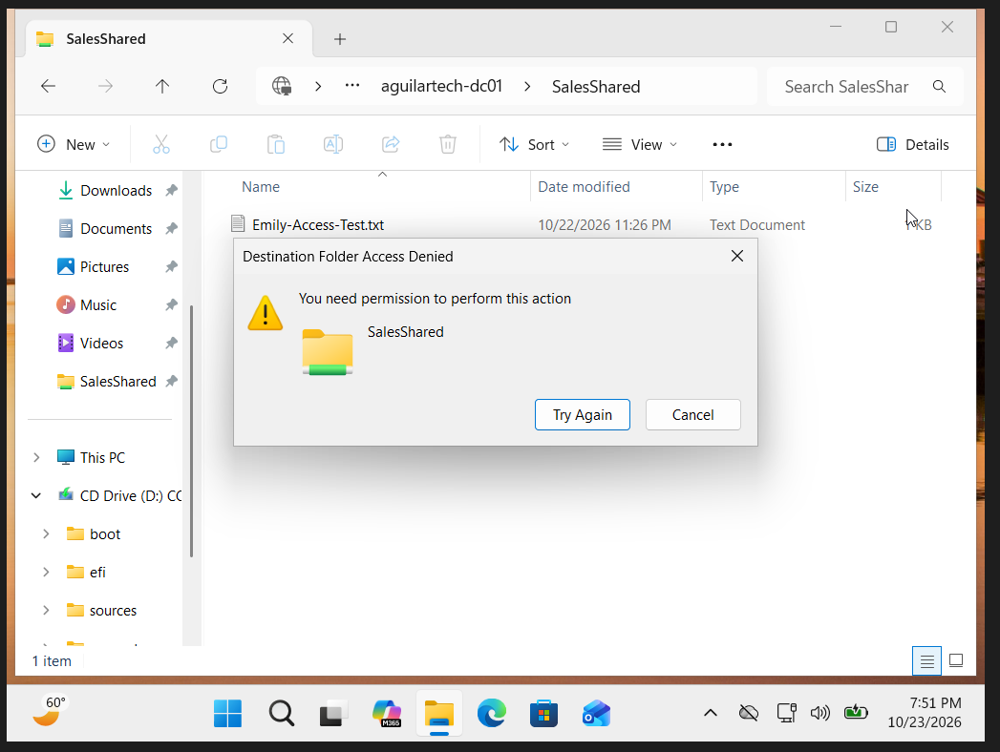
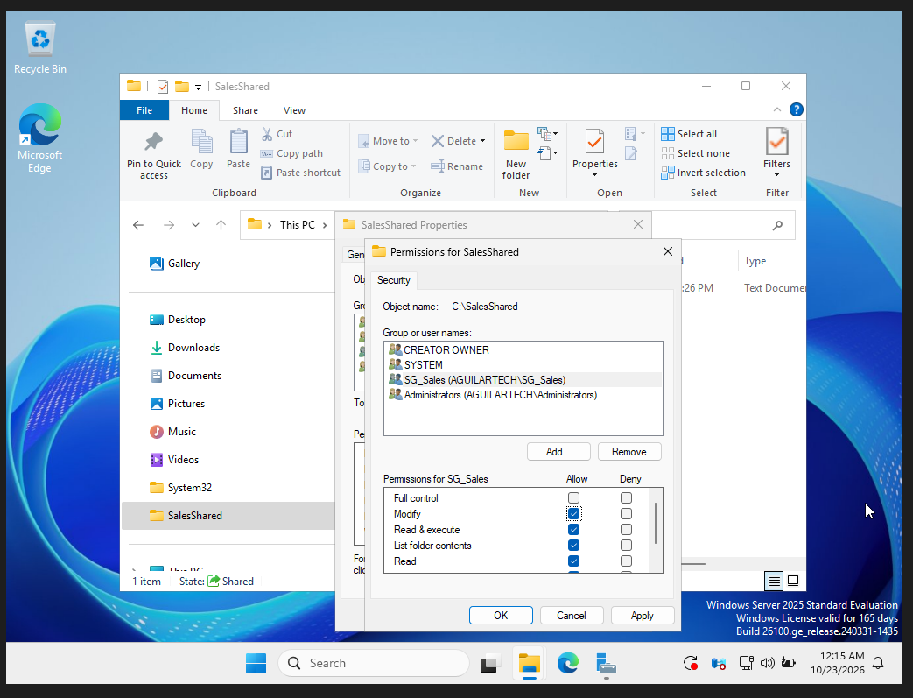
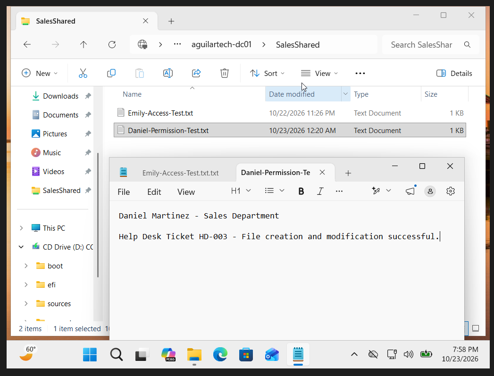

# Help Desk Ticket HD-003 - Shared Folder Permission Troubleshooting

**Ticket ID:** HD-003  
**Status:** Resolved  
**Category:** File Share / NTFS Permissions  
**Environment:** Windows Server 2025, Windows 11 Pro, Active Directory, Oracle VirtualBox

## Ticket Summary

A simulated employee, Daniel Martinez from the Sales department, reported that he could open the Sales shared folder and view files but could not create or modify documents.

The goal of this lab was to reproduce the problem, investigate the folder permissions, restore the appropriate access, and verify the resolution using the affected employee's account.

## Lab Environment

- **Server:** AGUILARTECH-DC01 (Windows Server 2025)
- **Workstation:** PC01 (Windows 11 Pro)
- **Domain:** aguilartech.local
- **Affected User:** Daniel Martinez
- **Security Group:** SG_Sales
- **Shared Folder:** C:\SalesShared
- **Network Path:** \\aguilartech-dc01\SalesShared
- **Virtualization:** Oracle VirtualBox

## Troubleshooting Steps

### 1. Investigated the Folder Permissions

Opened the Properties window for C:\SalesShared on the domain controller and reviewed the Security tab.

The SG_Sales security group originally had Modify permissions. To reproduce a realistic access issue, I intentionally removed Modify and Write permissions while keeping Read & Execute, List Folder Contents, and Read permissions enabled.

This created a scenario where Sales employees could view files but could not make changes.

### 2. Reproduced the Access Denied Error

Signed into the domain-joined Windows 11 workstation using Daniel Martinez's simulated employee account.

Opened the SalesShared folder and attempted to create a new document.

Windows displayed an error stating:

**Destination Folder Access Denied - You need permission to perform this action.**

This confirmed that the user could reach the folder but lacked permission to create files.

### 3. Identified and Resolved the Permission Issue

After checking the affected account's group membership and the folder's existing permissions, I identified that the SG_Sales group was missing Modify and Write permissions.

Returned to the folder's Security settings on DC01 and restored the Modify permission for SG_Sales, which also enabled the related permissions.

I restored the group's original access rather than assigning Daniel Full Control individually.

This followed the principle of least privilege and kept access management consistent through Active Directory security groups.

### 4. Verified the Solution

Returned to PC01 and accessed the SalesShared folder using Daniel's account.

Created a test document named Daniel-Permission-Test.txt and entered:

**Daniel Martinez - Sales Department**

**Help Desk Ticket HD-003 - File creation and modification successful.**

Saved the document and verified the content remained available.

This confirmed that the employee could create and edit files after restoring the permissions.

## Root Cause

The access issue was caused by intentionally removing NTFS Modify and Write permissions from the SG_Sales security group.

The group retained Read permissions, which allowed users to view files but prevented them from creating or modifying documents.

## Resolution

Restored NTFS Modify permissions for SG_Sales on the SalesShared folder.

Verified that Daniel Martinez could successfully create and modify files using his domain account.

**Outcome:** The simulated employee's shared-folder access issue was resolved.

## What I Learned

- How NTFS Read, Write, Modify, and Full Control permissions differ.
- How to investigate shared-folder access issues in Windows Server.
- Why security groups are better for managing departmental access than individual permissions.
- How the principle of least privilege helps reduce unnecessary access.
- Why testing with the affected user's access level is important.
- How to reproduce, troubleshoot, resolve, and document an access-denied issue.

## Skills Demonstrated

**Active Directory | NTFS Permissions | Security Groups | Shared Folder Troubleshooting | Windows Server | Windows 11 | Least Privilege | Technical Documentation**
