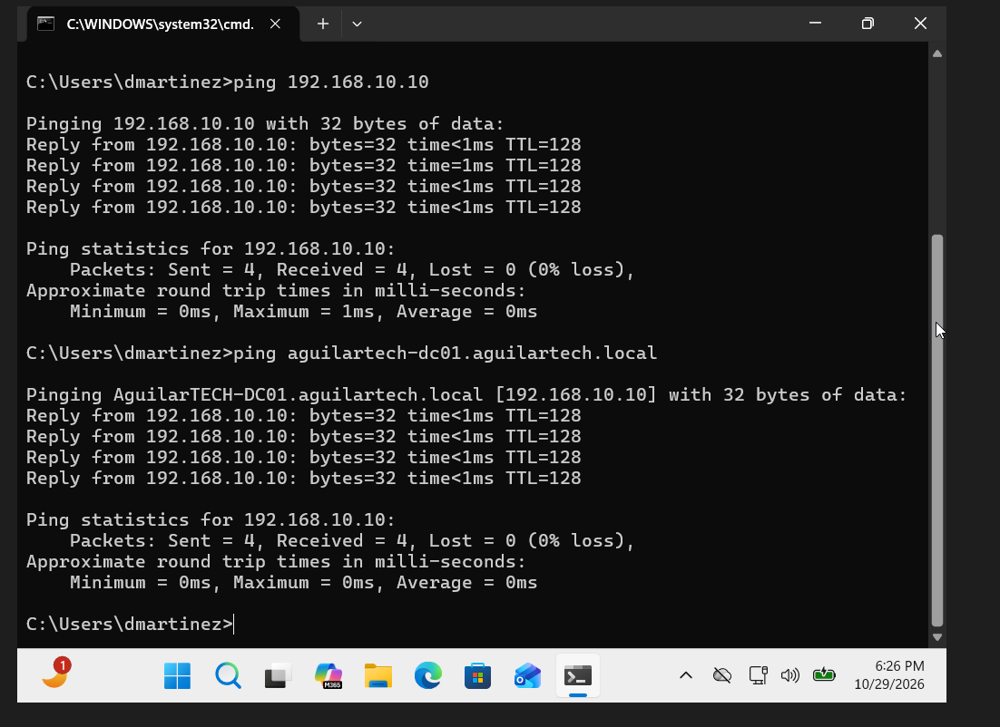
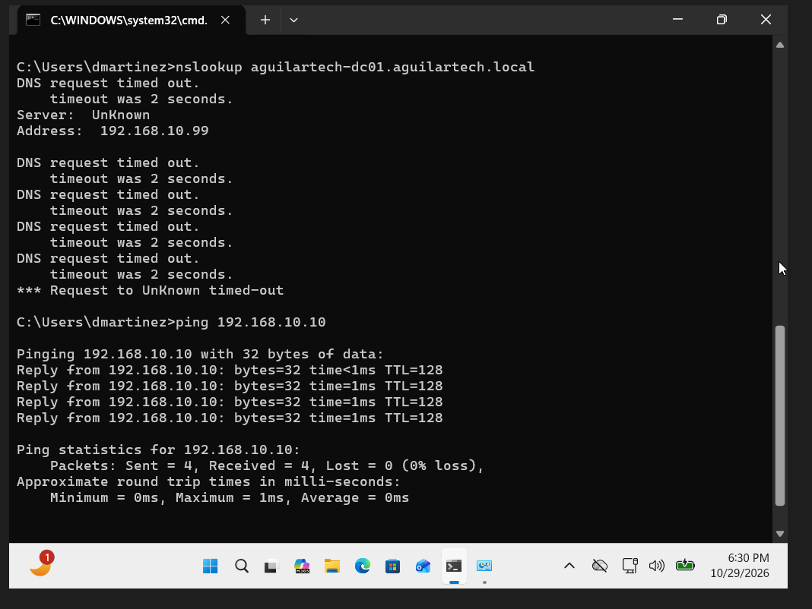
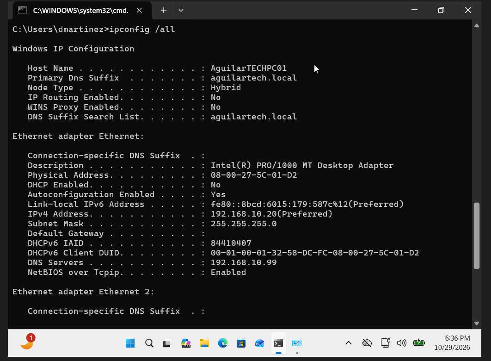
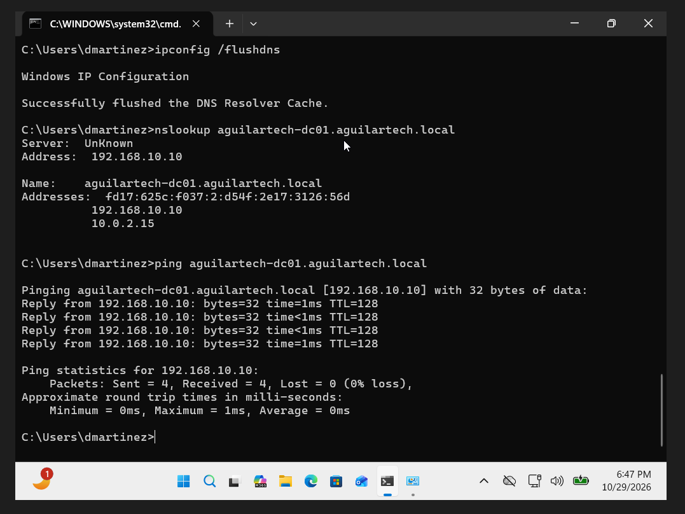

# Help Desk Ticket HD-004 - DNS Resolution Troubleshooting

**Ticket ID:** HD-004  
**Status:** Resolved  
**Category:** Networking / DNS Troubleshooting  
**Environment:** Windows Server, Windows 11 Pro, Active Directory, Oracle VirtualBox

## Issue Description

A simulated employee, Daniel Martinez from the Sales department, was unable to resolve the company's domain controller hostname.

The computer could communicate with the domain controller using its IP address, but DNS lookups were failing.

The goal of this lab was to diagnose a DNS configuration issue, restore hostname resolution, and verify that the computer could communicate with the domain controller again.

## Lab Environment

- **Domain Controller:** AguilarTECH-DC01 (Windows Server, DNS Server, Active Directory)
- **Workstation:** AguilarTECHPC01 (Windows 11 Pro)
- **Domain:** aguilartech.local
- **User:** Daniel Martinez (dmartinez)
- **Workstation IPv4:** 192.168.10.20
- **Domain Controller IPv4:** 192.168.10.10
- **Correct DNS Server:** 192.168.10.10
- **Virtualization:** Oracle VirtualBox

## Troubleshooting Steps

### 1. Verified Network Connectivity Before Introducing the Issue

Before beginning the troubleshooting scenario, I verified that the workstation could communicate with the domain controller using both its IP address and hostname.

Commands used:

```cmd
ping 192.168.10.10
ping aguilartech-dc01.aguilartech.local
```

Both commands returned four successful replies with 0% packet loss.

This confirmed that the workstation could reach the server and resolve its hostname before the simulated issue was introduced.



### 2. Reproduced the DNS Resolution Failure

To simulate a realistic DNS issue, I intentionally changed the workstation's preferred DNS server from `192.168.10.10` to `192.168.10.99`.

After clearing the DNS resolver cache, I tested hostname resolution using:

```cmd
ipconfig /flushdns
nslookup aguilartech-dc01.aguilartech.local
ping 192.168.10.10
```

The DNS lookup repeatedly timed out, but the workstation could still ping the domain controller's IP address successfully.

This suggested that basic IP connectivity was working, while DNS resolution was failing.



### 3. Investigated the Workstation's DNS Configuration

I ran the following command to review the workstation's network configuration:

```cmd
ipconfig /all
```

The results showed:

- **IPv4 Address:** 192.168.10.20
- **Subnet Mask:** 255.255.255.0
- **Configured DNS Server:** 192.168.10.99

The workstation was configured to use an incorrect DNS server address.

I knew the domain controller's DNS service was available at `192.168.10.10` because I had verified it during the initial connectivity tests.

This helped identify the incorrect DNS server configuration as the cause of the simulated problem.



### 4. Corrected the DNS Server Configuration

To resolve the issue, I opened the workstation's network adapter settings using:

```cmd
ncpa.cpl
```

I then opened the IPv4 properties for the internal Ethernet adapter and changed the preferred DNS server:

**Incorrect:** 192.168.10.99  
**Correct:** 192.168.10.10

I left the workstation's IPv4 address and subnet mask unchanged.

### 5. Verified the Solution

After restoring the correct DNS server, I opened Command Prompt and ran:

```cmd
ipconfig /flushdns
nslookup aguilartech-dc01.aguilartech.local
ping aguilartech-dc01.aguilartech.local
```

The DNS resolver cache was cleared successfully.

The `nslookup` command successfully resolved the domain controller's hostname, and the hostname ping returned four successful replies with 0% packet loss.

This confirmed that DNS hostname resolution was restored.



## Root Cause

The workstation was configured to use an incorrect DNS server (`192.168.10.99`) instead of the intended internal DNS server (`192.168.10.10`).

Because DNS requests to the incorrect address timed out, the workstation could not resolve the domain controller's hostname through that DNS server.

Basic network connectivity remained available, which was confirmed by successful pings to the domain controller's IPv4 address.

## Resolution

Restored the correct DNS server address on the workstation, cleared the DNS resolver cache, and verified successful hostname resolution and network connectivity.

**Final Status: Resolved**

## What I Learned

This lab helped me better understand how DNS works and why it is important in an Active Directory environment.

I learned that being able to ping a server by its IP address does not necessarily mean DNS is working correctly.

I also practiced using `ping`, `nslookup`, and `ipconfig /all` to investigate networking problems.

Another important lesson was that a workstation's IPv4 address and DNS server address do not need to match. The DNS server address needs to point to a valid DNS server that can resolve the required hostnames.

In a real workplace, I would verify the correct DNS server by checking company documentation, DHCP settings, or comparing the configuration with a known-working workstation before making any changes.

This experience helped me practice identifying a problem, investigating the cause, applying a solution, and verifying that the issue was resolved.
