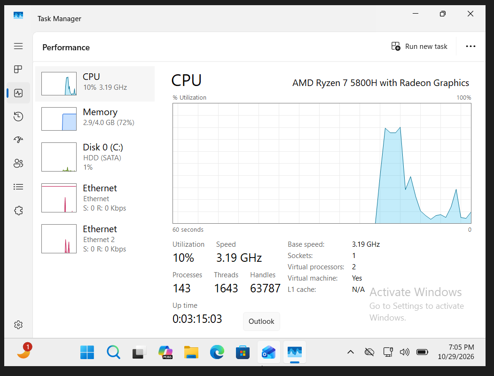
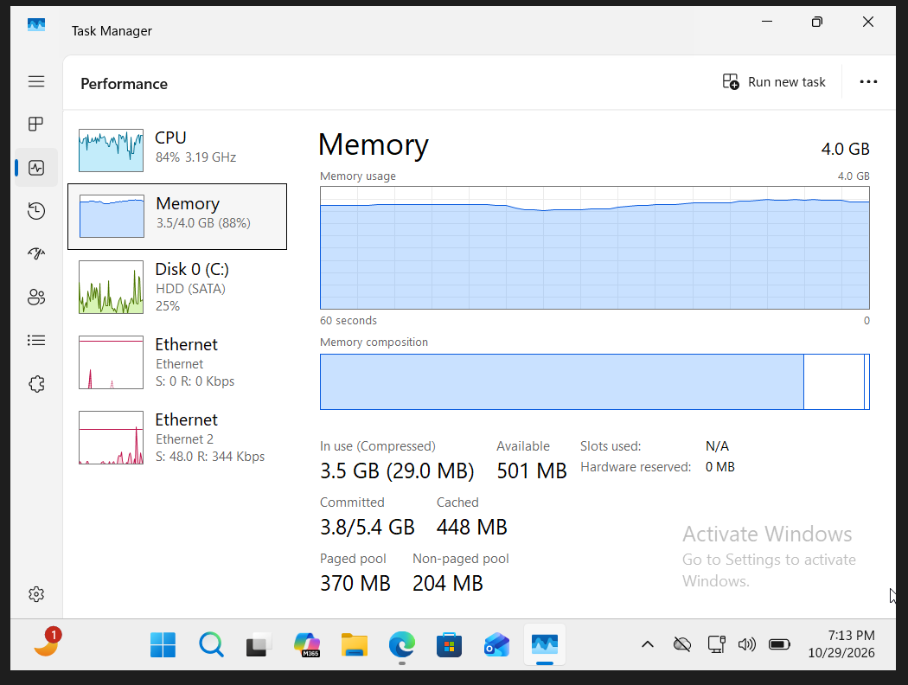
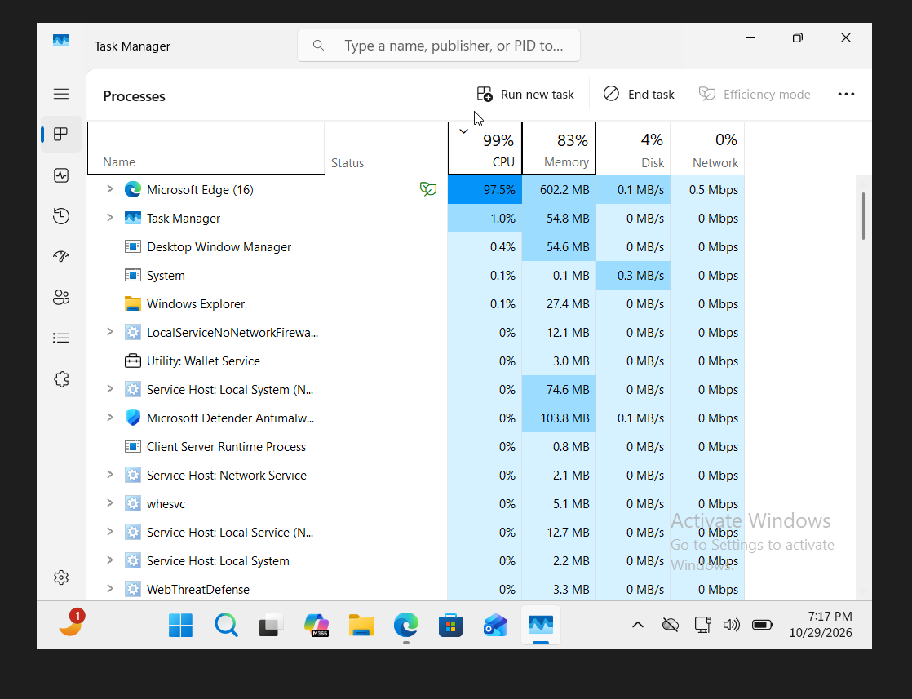
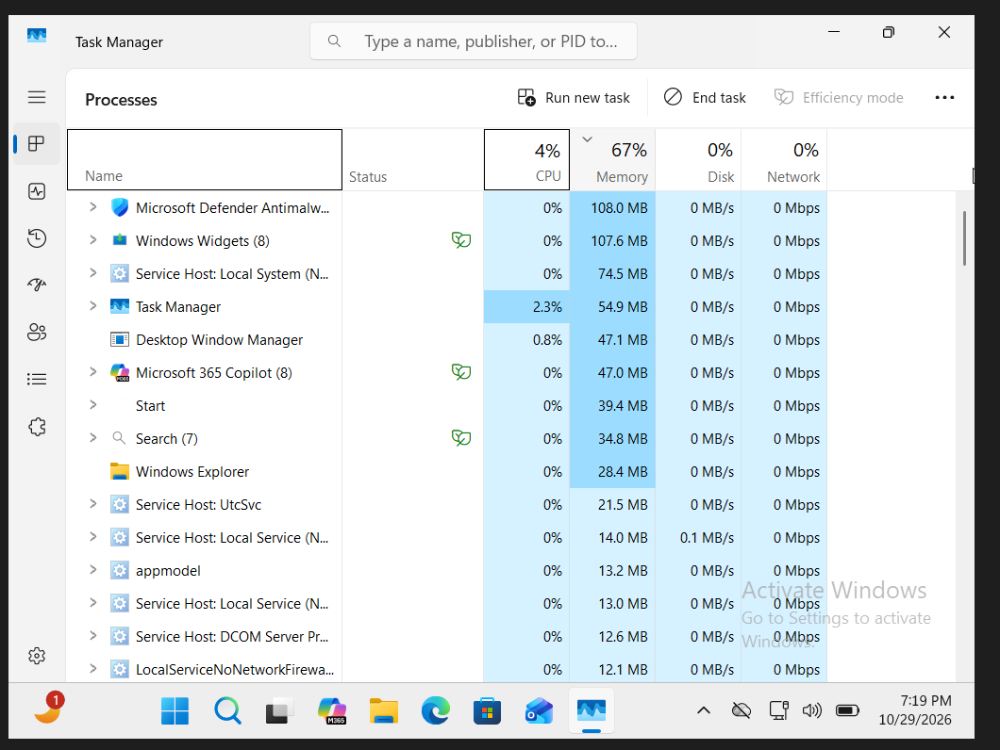

# Help Desk Ticket HD-005 - Windows Performance Troubleshooting

**Ticket ID:** HD-005  
**Status:** Resolved  
**Category:** Windows Performance / Desktop Support  
**Environment:** Windows 11 Pro, Task Manager, Oracle VirtualBox

## Issue Description

A simulated employee, Daniel Martinez from the Sales department, reported that his Windows 11 computer was running slowly, especially when opening applications and switching between windows.

The goal of this lab was to investigate the computer's resource usage, identify the process contributing to the slowdown, apply a solution, and verify that system performance improved.

To reproduce the issue, I opened multiple browser tabs and monitored how they affected CPU and memory usage.

## Lab Environment

- **Workstation:** AguilarTECHPC01 (Windows 11 Pro)
- **Domain:** aguilartech.local
- **Employee:** Daniel Martinez (dmartinez)
- **Virtualization:** Oracle VirtualBox
- **Virtual Processors:** 2
- **Allocated RAM:** 4 GB
- **Troubleshooting Tool:** Windows Task Manager

## Troubleshooting Steps

### 1. Investigated Initial System Performance

Before introducing the performance issue, I opened Windows Task Manager using `Ctrl + Shift + Esc` and reviewed the Performance tab.

The initial readings showed:

- **CPU Usage:** Approximately 10%
- **Memory Usage:** 72% (2.9 GB out of 4 GB)
- **Disk Usage:** Approximately 1%

CPU and disk activity were relatively low, although Windows was already using most of the allocated memory.

I also reviewed the Processes tab to identify applications using system resources.

No individual application appeared to be consuming an unusually large amount of memory at this stage.

### 2. Reproduced the Performance Issue

To simulate a realistic slowdown, I opened multiple tabs in Microsoft Edge while monitoring system performance.

As the browser workload increased, I observed the following:

- **CPU Usage:** Increased to approximately 84%
- **Memory Usage:** Increased to 88% (3.5 GB out of 4 GB)
- **Disk Activity:** Approximately 25% at the time of the screenshot

The workstation had approximately 501 MB of available memory remaining.

These readings showed that opening additional browser tabs significantly increased resource usage.

### 3. Identified the Process Consuming System Resources

I opened Task Manager's Processes tab and sorted the running processes by CPU usage.

The results showed:

- **Total CPU Usage:** 99%
- **Total Memory Usage:** 83%
- **Microsoft Edge CPU Usage:** 97.5%
- **Microsoft Edge Memory Usage:** Approximately 602 MB

Microsoft Edge was consuming nearly all the available CPU capacity during the test.

This indicated that the browser workload was the main contributor to the high CPU usage.

Rather than immediately recommending a hardware upgrade, I focused on identifying unnecessary applications and reducing resource consumption.

### 4. Applied the Solution

Before closing the browser, I considered whether the employee might have important work or unsaved information open.

In a real Help Desk situation, I would ask the employee to save any important work before closing applications.

To resolve the simulated issue, I closed the unnecessary browser tabs and exited Microsoft Edge normally.

I avoided ending unrelated Windows processes or changing important system settings.

### 5. Verified System Performance Improved

After closing Microsoft Edge, I returned to Task Manager and checked the system's resource usage.

The results showed:

- **CPU Usage:** Decreased from 99% to 4%
- **Memory Usage:** Decreased from 83% to 67%
- **Disk Usage:** Returned to 0%

The significant decrease in CPU and memory usage provided evidence that closing the browser workload successfully reduced system resource consumption.

## Root Cause

The simulated performance issue was caused by excessive CPU usage associated with Microsoft Edge while multiple browser tabs were open.

The Windows 11 virtual machine had only 4 GB of allocated RAM and two virtual processors, which limited the resources available for running multiple applications.

During testing, Microsoft Edge consumed approximately 97.5% of CPU capacity, contributing to the high system utilization.

## Resolution

Closed unnecessary browser tabs and exited Microsoft Edge normally.

Afterward, CPU usage decreased to approximately 4%, and memory usage decreased to 67%.

The improvement confirmed that the browser workload was responsible for much of the increased resource usage.

**Final Status: Resolved**

## What I Learned

This lab helped me better understand how to troubleshoot slow computer performance using Windows Task Manager.

I learned how to monitor CPU, memory, and disk usage and identify which processes are consuming the most resources.

I also learned that high memory usage does not automatically mean a computer needs more RAM. Before recommending hardware upgrades, it is important to investigate running applications and background processes.

Another important lesson was to ask users whether they have important or unsaved work open before closing applications.

By comparing performance before, during, and after the simulated issue, I practiced identifying a likely cause, applying a solution, and verifying the results.

This experience helped me develop practical Windows troubleshooting skills that are useful in entry-level Help Desk and Desktop Support positions.
