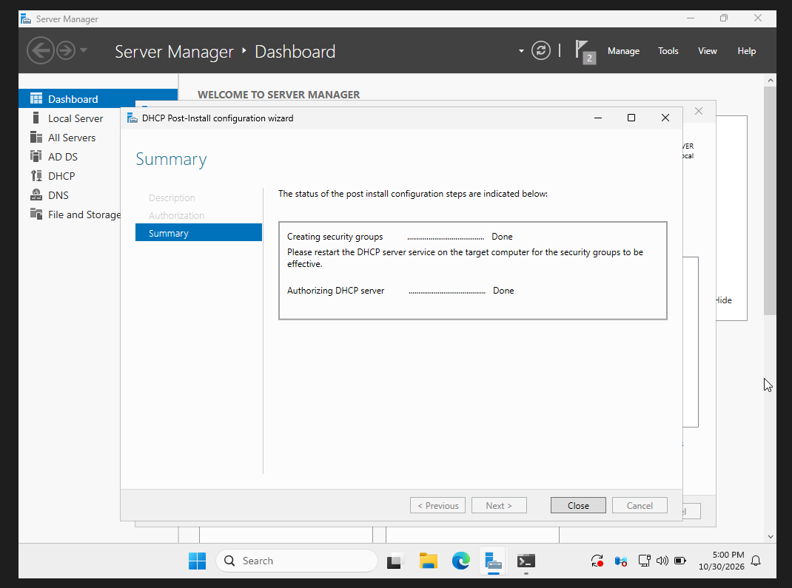
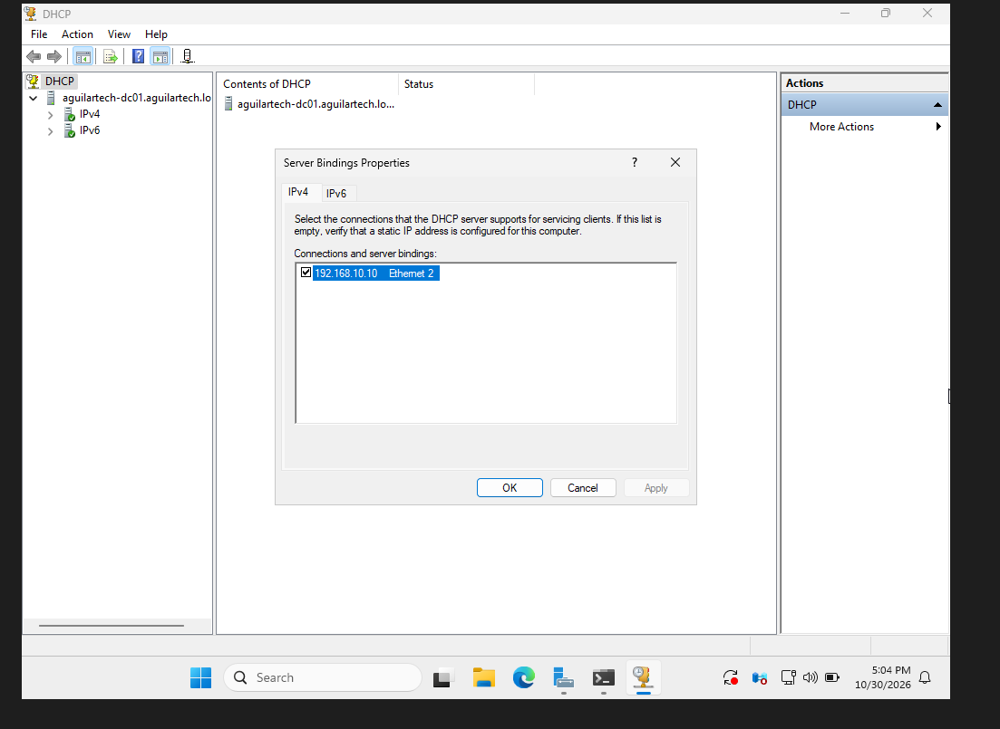
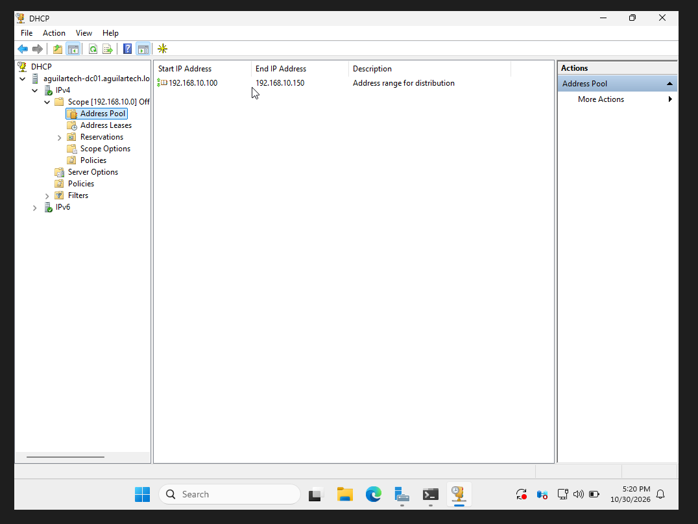
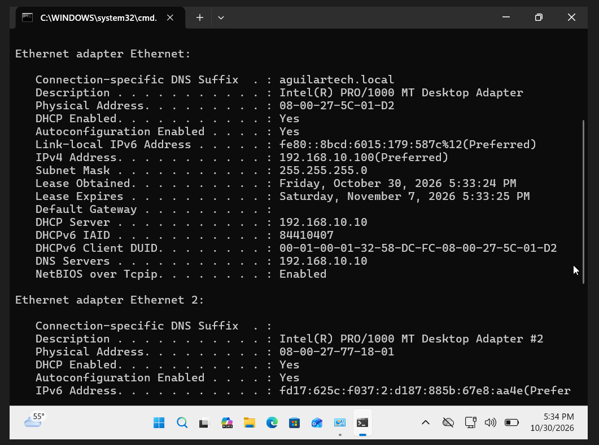
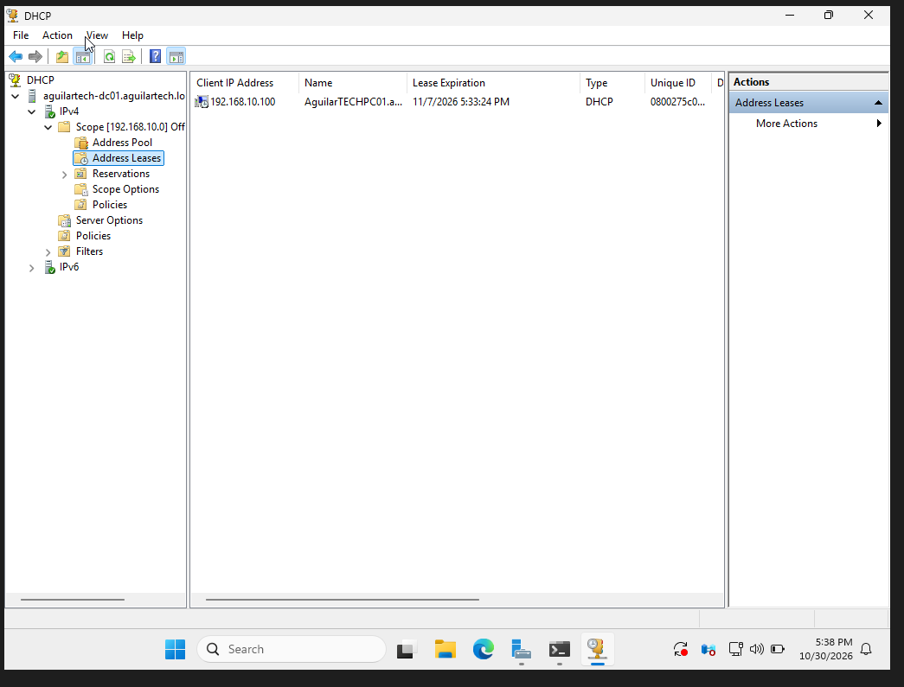
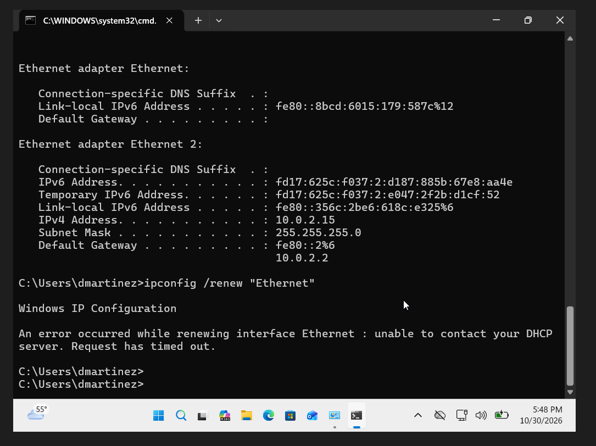
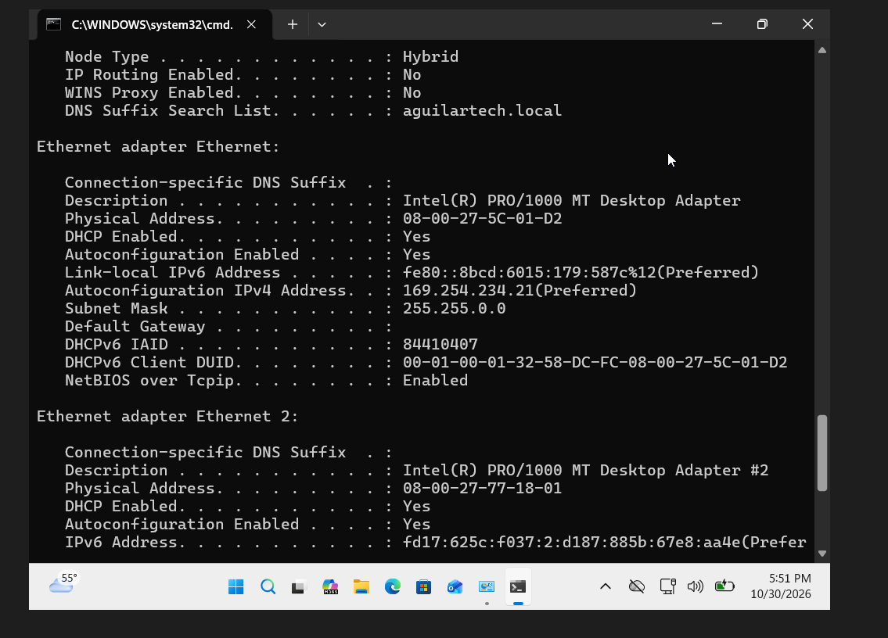
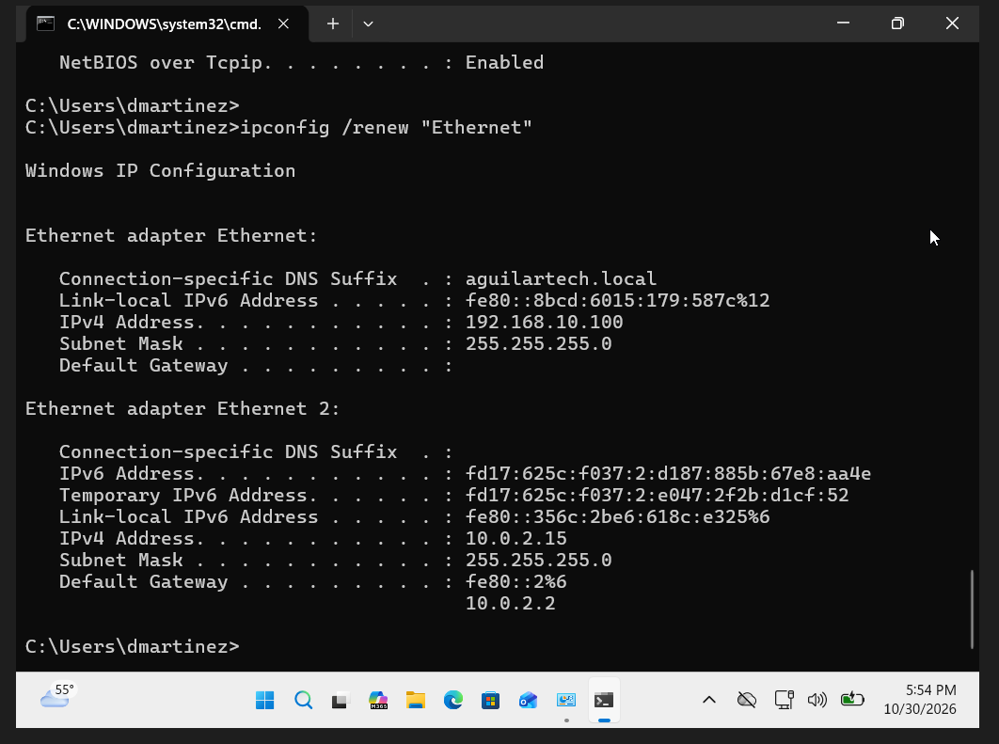

# Help Desk Ticket HD-006 — DHCP Configuration and Troubleshooting

**Ticket ID:** HD-006  
**Status:** Resolved — DHCP connectivity  
**Category:** Network Troubleshooting / DHCP  
**Environment:** Windows Server 2025, Windows 11 Pro, Active Directory, Oracle VirtualBox

## Issue Description

A simulated employee, Daniel Martinez from the Sales department, reported that his workstation was unable to obtain a valid network configuration.

The goal of this project was to configure a Windows DHCP server, verify automatic IP address assignment, simulate a DHCP service failure, investigate the resulting connectivity issue, and restore normal DHCP operation.

## Lab Environment

- **DC01:** Windows Server 2025 — Domain Controller, DNS Server, DHCP Server
- **PC01:** Windows 11 Pro — Domain-joined workstation
- **Domain:** `aguilartech.local`
- **DC01 Internal IP:** `192.168.10.10`
- **Network:** `192.168.10.0/24`
- **DHCP Scope:** `192.168.10.100–192.168.10.150`
- **Subnet Mask:** `255.255.255.0`
- **DNS Server:** `192.168.10.10`
- **Lease Duration:** 8 days
- **Virtualization:** Oracle VirtualBox

## Troubleshooting and Configuration Steps

### 1. Installed and Authorized the DHCP Server

Opened Server Manager on DC01 and installed the DHCP Server role through the Add Roles and Features Wizard.

Completed the post-install configuration, including creating DHCP security groups and authorizing the server in Active Directory.

Verified that both post-installation tasks completed successfully.

### 2. Verified DHCP Network Bindings

Opened DHCP Manager and checked the server's network bindings.

Confirmed that DHCP was bound to the internal Ethernet 2 adapter using IP address `192.168.10.10`.

This ensured the DHCP service was configured to respond to clients on the lab network rather than the separate VirtualBox NAT connection.

### 3. Created and Configured a DHCP Scope

Created a DHCP scope named `Office-Workstations` with the following configuration:

- **Starting IP:** `192.168.10.100`
- **Ending IP:** `192.168.10.150`
- **Subnet Mask:** `255.255.255.0`
- **DNS Server:** `192.168.10.10`
- **DNS Domain:** `aguilartech.local`
- **Lease Duration:** 8 days

No default gateway was configured for the isolated internal lab network.

Also verified that the VirtualBox Host-Only DHCP service was disabled to prevent competing DHCP servers.

Activated the scope and verified that the correct address range appeared in DHCP Manager.

### 4. Verified Automatic IP Address Assignment

On PC01, changed the internal Ethernet adapter from static addressing to automatic IP and DNS configuration.

Ran `ipconfig /all` and confirmed:

- DHCP Enabled: Yes
- Assigned IPv4 Address: `192.168.10.100`
- Subnet Mask: `255.255.255.0`
- DHCP Server: `192.168.10.10`
- DNS Server: `192.168.10.10`

This confirmed that PC01 successfully received an IP address and DNS settings from DC01.

### 5. Confirmed the DHCP Lease on DC01

Opened DHCP Manager on DC01 and navigated to the Address Leases section.

Verified that PC01 appeared with the assigned address `192.168.10.100` and a valid lease expiration date.

Also successfully tested connectivity to DC01 using its IP address and hostname before simulating the failure.

### 6. Simulated a DHCP Service Failure

To recreate a realistic network problem, I intentionally stopped the DHCP Server service on DC01.

On PC01, released the existing address using:

`ipconfig /release "Ethernet"`

Then attempted to obtain another lease using:

`ipconfig /renew "Ethernet"`

The request failed with the following error:

*Unable to contact your DHCP server. Request has timed out.*

This demonstrated that PC01 could no longer obtain a new IPv4 lease while the DHCP Server service was unavailable.

### 7. Investigated the APIPA Address

After the failed renewal, ran `ipconfig /all` on PC01.

Windows had automatically assigned the following configuration:

- **IPv4 Address:** `169.254.234.21`
- **Subnet Mask:** `255.255.0.0`
- **Default Gateway:** None

Recognized this as an APIPA (Automatic Private IP Addressing) address.

This indicated that the DHCP-enabled workstation had failed to obtain a usable IPv4 lease and assigned itself a link-local address.

The APIPA address did not belong to the company's `192.168.10.0/24` network.

### 8. Restored the DHCP Service

Returned to DC01 and restarted the DHCP Server service.

After confirming that the service was running, returned to PC01 and executed:

`ipconfig /renew "Ethernet"`

The renewal completed successfully, and PC01 received the address `192.168.10.100` again with the correct subnet mask.

This verified that restoring the DHCP service allowed PC01 to obtain a valid IPv4 configuration.

## Root Cause

The simulated network configuration failure occurred because the DHCP Server service on DC01 had been intentionally stopped.

Without an available DHCP service, PC01 could not obtain a new IPv4 lease and eventually assigned itself an APIPA address.

## Resolution

Restarted the DHCP Server service on DC01 and renewed PC01's IP address.

The workstation successfully obtained a valid DHCP lease from the configured scope.

**Final Status: DHCP issue resolved.**

A separate shared-folder access-denied issue was discovered during additional testing. This remains outside the DHCP resolution and requires separate investigation.

## What I Learned

This project helped me understand how DHCP automatically assigns IP addresses and other network settings to computers.

I learned how to install and authorize the DHCP Server role, create an address scope, configure DNS options, and verify active DHCP leases.

I also learned how to recognize an APIPA address and what it can indicate when a workstation cannot contact a DHCP server.

An important troubleshooting lesson was that a computer can continue using an existing valid DHCP lease even when the DHCP server becomes temporarily unavailable.

By intentionally stopping the DHCP service, reproducing a failed lease renewal, investigating the IP configuration, and restoring the service, I practiced a realistic network troubleshooting process.

This project strengthened my understanding of Windows Server administration, DHCP, IPv4 addressing, and Help Desk network support.
