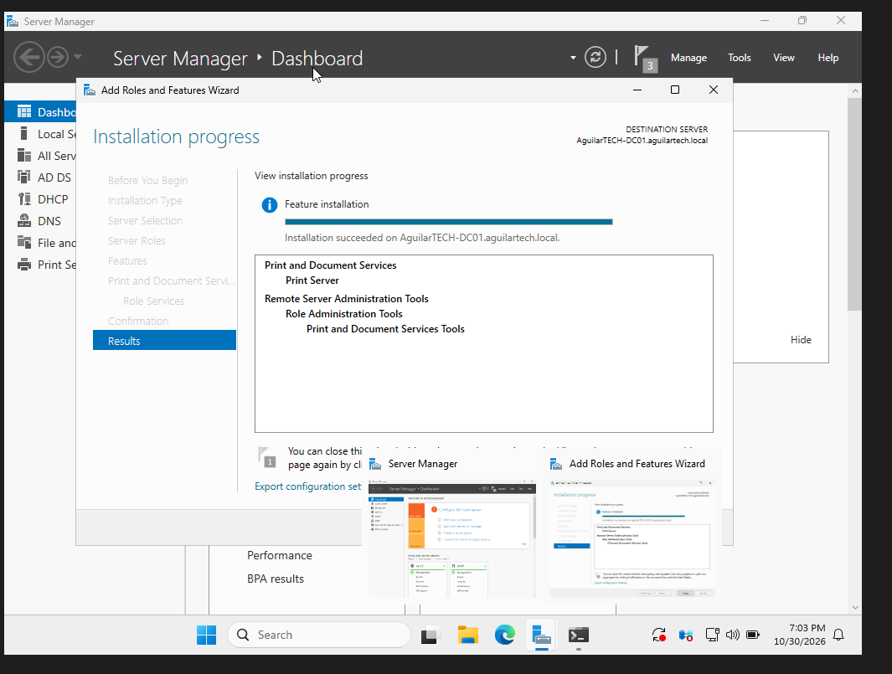
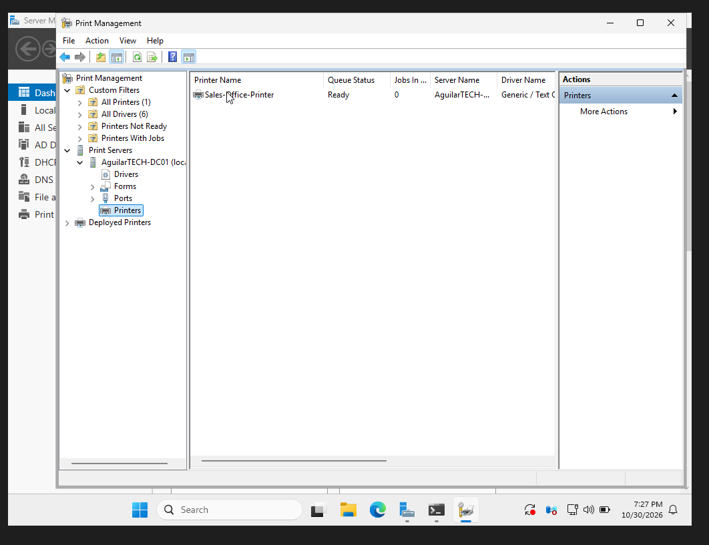
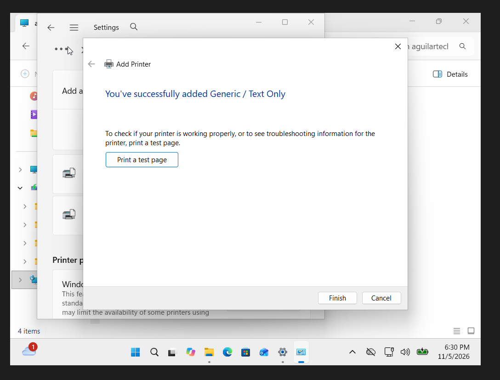
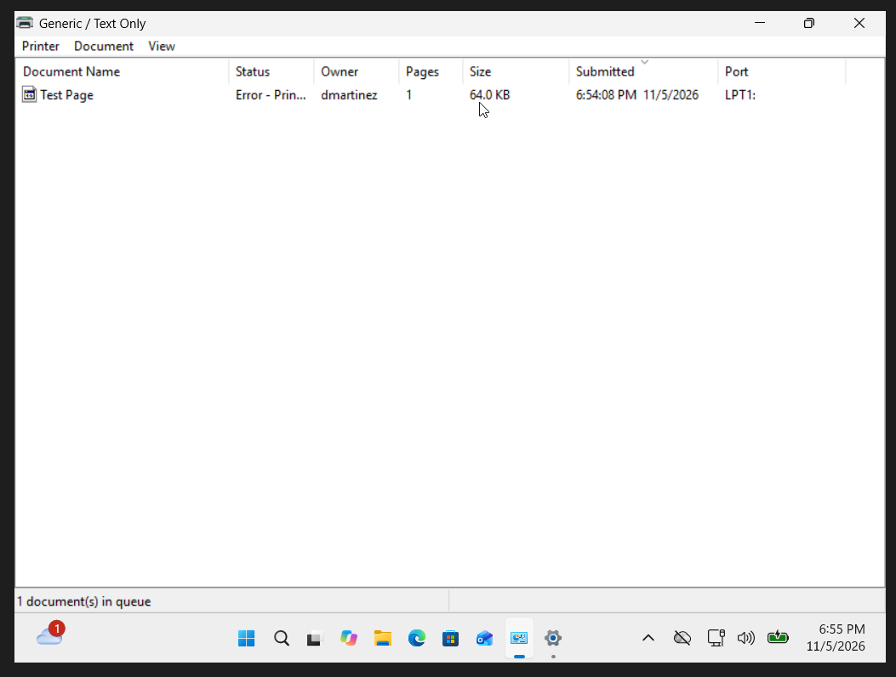
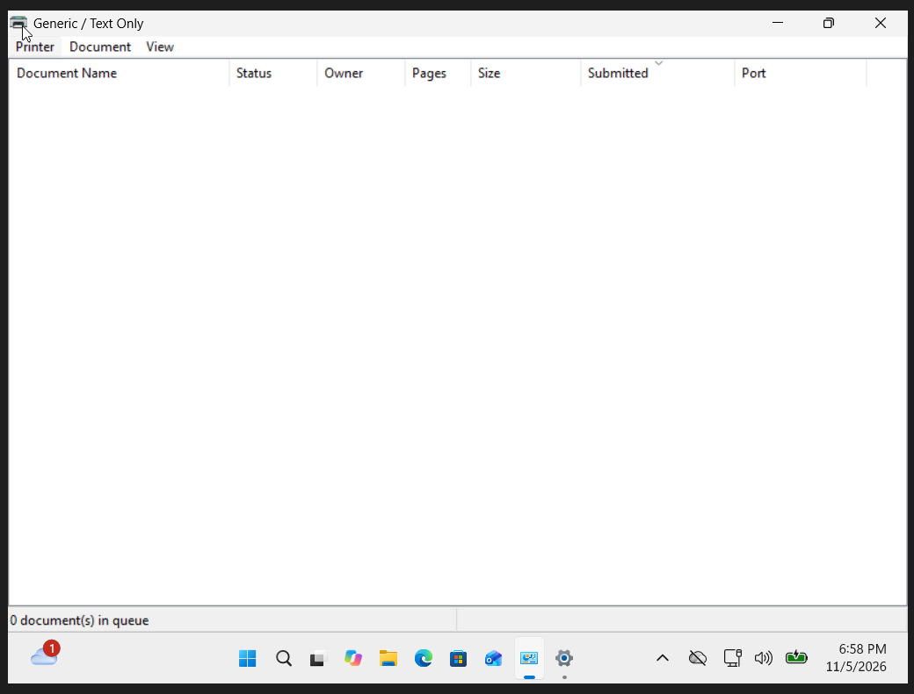

# Help Desk Ticket HD-007 - Printer Installation and Print Queue Troubleshooting

## Issue Description

An employee reported that their printer was not working correctly. Documents were getting stuck in the print queue and displaying an error instead of completing.

I used my Windows Server and Windows 11 home lab to simulate a printer issue, investigate the cause, and restore normal print queue operation.

## Lab Environment

- **DC01:** Windows Server with Print and Document Services installed.
- **PC01:** Windows 11 Pro workstation signed in as Daniel Martinez.
- **Virtualization:** Oracle VirtualBox.
- **Printer Driver:** Generic / Text Only.
- **Tools Used:** Print Management, Windows Printer Properties, Print Queue, and PowerShell.

## Troubleshooting Steps

### 1. Installed the Print Server Role

Opened Server Manager on DC01 and installed Print and Document Services, including the Print Server role.

Verified that the installation completed successfully.

### 2. Configured the Sales Office Printer

Opened Print Management on DC01 and created a simulated printer named `Sales-Office-Printer`.

Installed the Generic / Text Only driver and configured the printer for sharing.

Verified that the printer appeared in Print Management with a Ready status.

### 3. Installed a Local Printer on PC01

Installed a separate Generic / Text Only printer on the Windows 11 workstation using the built-in printer installation wizard.

Configured the printer using the `PORTPROMPT:` local port to simulate printing without physical printer hardware.

Verified that Windows successfully installed the printer.

### 4. Investigated the Print Queue Error

Simulated a printer connection issue by changing the local printer port to `LPT1:`, which had no physical printer connected.

Sent a test page and opened the classic Windows print queue.

The document remained in the queue with an Error - Printing status.

This showed that Windows could recognize the printer and submit the document, but the print job could not complete through the selected port.

### 5. Corrected the Printer Configuration

Investigated the printer's port configuration and identified that the selected `LPT1:` port did not have a connected printer.

Canceled the failed print job and changed the printer port back to `PORTPROMPT:`.

Sent another test page, saved the output as a file, and confirmed that the print queue no longer contained a failed job.

## Resolution

The simulated printing issue was caused by an incorrect printer port configuration.

After correcting the port and clearing the failed job, Windows successfully processed a new print-to-file request, and the printer queue was clear.

## What I Learned

- How to install and configure the Print Server role in Windows Server.
- How to install and manage printer drivers.
- How to configure shared and local printers.
- How to investigate failed documents in a Windows print queue.
- How incorrect printer port settings can prevent print jobs from completing.
- How to correct printer configurations and verify the results.

This project helped me understand how Help Desk technicians can troubleshoot printer issues by checking printer settings, drivers, ports, and print queues before making unnecessary changes to the system.

**Ticket Status:** Resolved — Local simulated printer issue.
